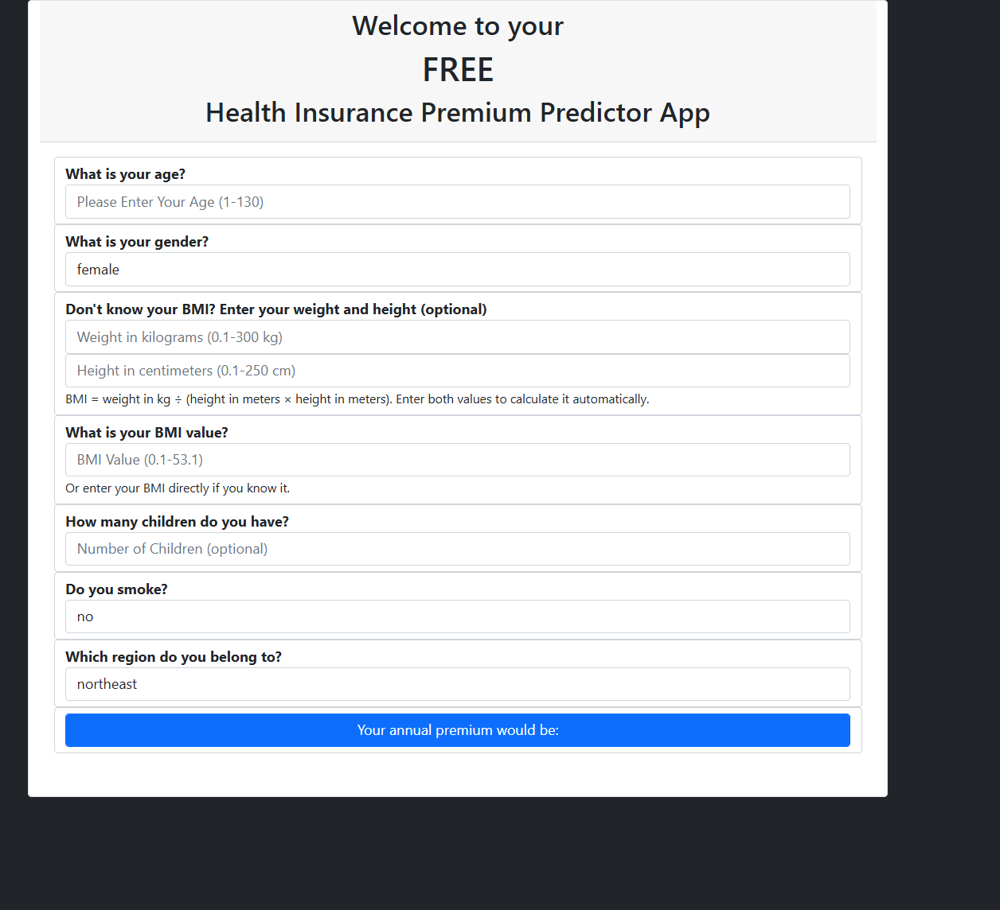
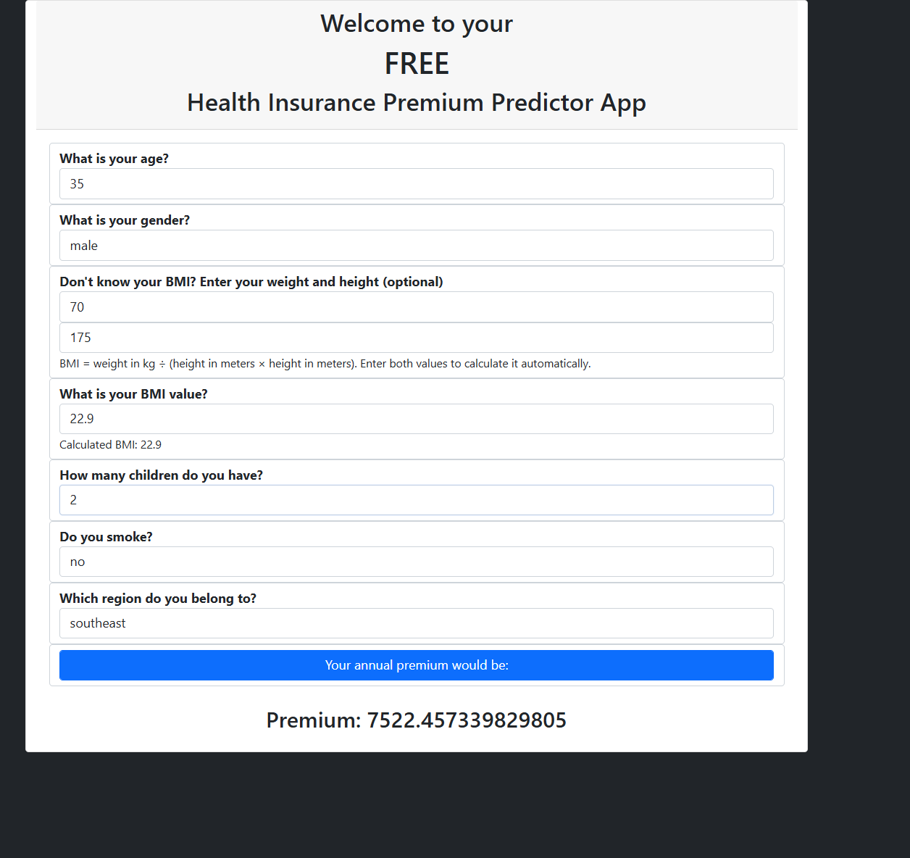

# Insurance Premium Prediction | iNeuron | Internship Project

**Prepared by: Rakesh Ranjan**

## Problem Statement :

The goal of this project to give people an estimate of how much they need based on their individual health situation. After that, customers can work with any health insurance carrier and its plans and perks whilwe keeping the projected cost from our study in mind. This can assist a person in concentrating on the health side of an insurance policy rather than the ineffective part.

## Dataset :

The dataset is taken from a Kaggle. You can download the dataset from [here](https://www.kaggle.com/noordeen/insurance-premium-prediction)

## Approach :

Applying machine learing tasks like Data Exploration, Data Cleaning, Feature Engineering, Model Building and model testing to build a solution that should able to predict the premium of the personal for health insurance.

- **Data Exploration :** Exploring the dataset using pandas, numpy, matplotlib, plotly and seaborn.
- **Exploratory Data Analysis :** Plotted different graphs to get more insights about dependent and independent variables/features.
- **Feature Engineering :** Numerical features scaled down and Categorical features encoded.
- **Model Building :** In this step, first dataset Splitting is done. After that model is trained on different Machine Learning Algorithms such as:
  1) Linear Regression
  2) Decision Tree Regression
  3) Random Forest Regressor
  4) Gradient Boosting Regressor
  5) KNN Regressor
  6) XG Boost Regressor
- **Model Selection :** Tested all the models to check the RMSE & R-squared.
- **Pickle File** : Selected model as per best RMSE score & R-squared and created pickle file using pickle library.
- **Webpage &Deployment :** Created a web application that takes all the necessary inputs from the user & shows the output. Then deployed project on the Heroku Platform.

## Deployment Link :

https://insurance-premium-prediction1.herokuapp.com/

## Web Interface

The current form supports automatic BMI calculation from optional weight and height entries, as well as direct BMI entry. The example below shows a sample prediction.

## Libraries used :

    1) Pandas, Numpy
    3) Matplotlib, Seaborn, Plotly
    4) Scikit-Learn
    5) Flask, XG Boost, Pickle
    6) HTML
    7) CSS

## Technical Aspects :

    1) Programming Language : Python
    2) Front-end : HTML, CSS
    3) Back-end : Flask
    4) Deployment : Heruko

## App inputs and validation

- Age is required and must be a whole number from 1 to 130.
- Enter BMI directly, or provide both optional weight (kg) and height (cm) values to calculate it. BMI is calculated as `weight (kg) / height (m)^2`.
- Weight must be greater than 0 and at most 300 kg; height must be greater than 0 and at most 250 cm. If either is entered, both are required.
- BMI must be greater than 0 and at most 53.1. This upper limit matches the maximum BMI in `clean_data.csv`.
- The form displays an age-based healthy-BMI reference for information only; it does not block a prediction. Pediatric references are based on age and the selected sex, and predictions for people under 18 are outside the model's adult training data.
- Number of children is optional; a blank value is treated as 0. If supplied, it must be a whole number from 0 to 10.
- Sex, smoker status, and region are selected from the values in `clean_data.csv`.

The browser provides input hints and validation, and the Flask endpoint validates submitted values again before making a prediction. Height and weight limits are broad input sanity limits; the BMI limit also keeps predictions within the range observed in the cleaned dataset.
