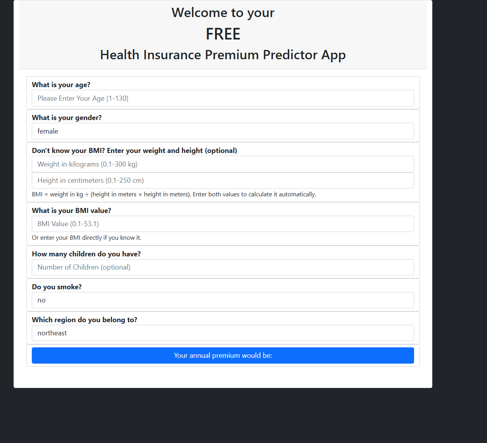
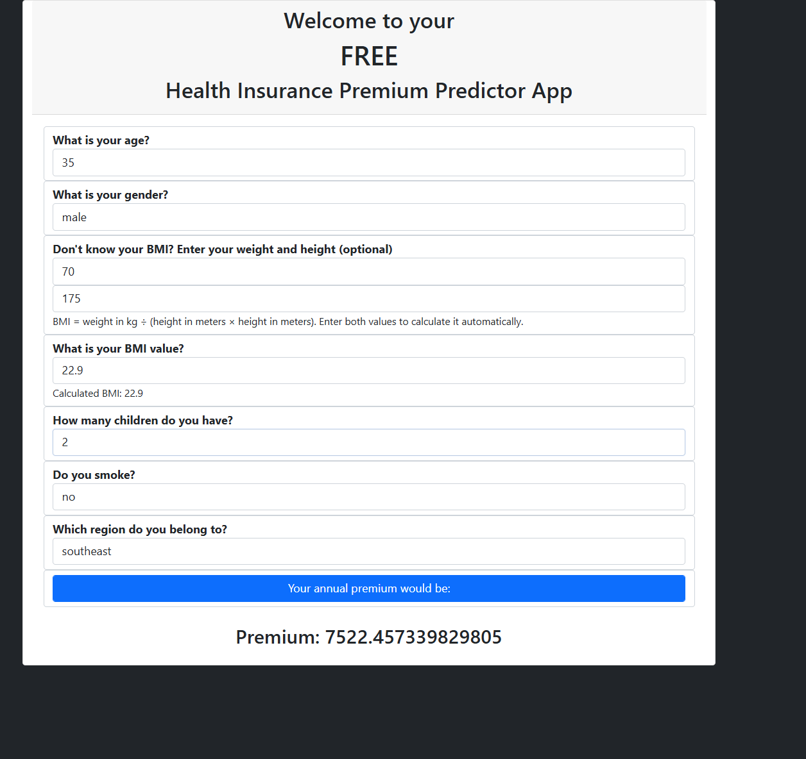

# Insurance Premium Prediction App

**Prepared by: Rakesh Ranjan**

This folder contains a runnable copy of the updated Flask app, the model and data it needs, and screenshots of the current interface.

## Run the app on Windows

Open PowerShell in this folder. Reuse the virtual environment already created outside OneDrive for this app:

```powershell
$python = "$env:LOCALAPPDATA\Packages\PythonSoftwareFoundation.Python.3.11_qbz5n2kfra8p0\LocalCache\Local\venvs\insurance-premium-prediction-p\Scripts\python.exe"
& $python -m pip install -r requirements.txt
& $python app.py
```

If you create a different environment, use its `Scripts\python.exe` path instead. If `python -m venv` reports an "Actual location", use that location for the interpreter path.

If you run the app from VS Code, use **Python: Select Interpreter** and choose the same virtual environment before running `app.py`. The model was saved with scikit-learn 1.2.0; other versions may not be able to load this pickle.

Debug mode is off by default. To enable it for local development in PowerShell, set the flag before starting the app:

```powershell
$env:FLASK_DEBUG = "1"
& $python app.py
```

To turn it off again in the current PowerShell session, run `Remove-Item Env:FLASK_DEBUG`. Do not enable Flask debug mode in a public or production deployment; use a production WSGI server instead.

Open <http://127.0.0.1:1947> in a browser.

## Files

- `app.py` — Flask routes, input validation, BMI calculation, and model prediction.
- `templates/index.html` — web form, browser-side checks, and BMI calculation display.
- `clean_data.csv` — source for the dropdown options.
- `gradient_boosting_regressor_model.pkl` — trained prediction model.
- `requirements.txt` — packages used by this app.
- `image/README/` — screenshots of the current form and a sample prediction.
- `APP_LOGIC_AND_SETUP.md` — detailed explanation of the app behavior and validation.
- `HLD.md` — high-level system design and request flows.
- `LLD.md` — routes, field contract, validation sequence, and test scenarios.
- `WIREFRAME.md` — form layout and interaction states.
- `ARCHITECTURE_DESIGN.md` — component architecture, data flow, and operational considerations.
- `Insurance_Premium_Prediction_Executive_Project_Report.pptx` — concise executive presentation.

## Interface




