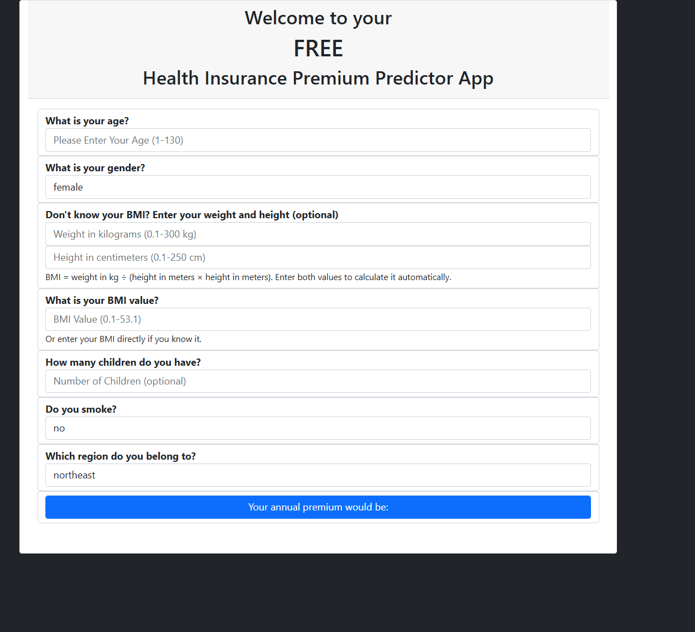
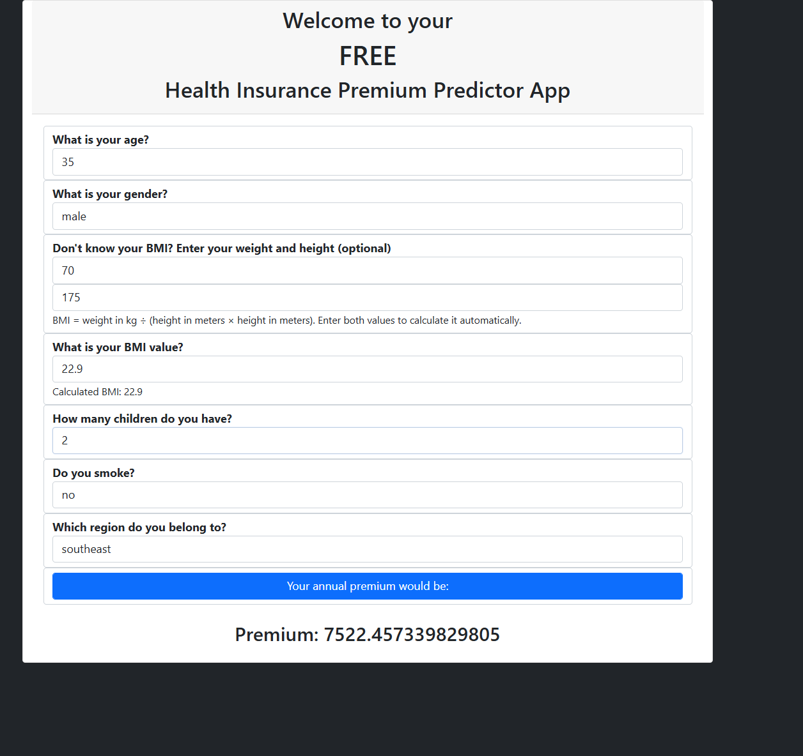

# Wireframe Document

**Project:** Insurance Premium Prediction App  
**Prepared by:** Rakesh Ranjan  
**Wireframe type:** Current desktop form, represented schematically

## 1. Page structure

```text
┌─────────────────────────────────────────────────────────────────────┐
│              Welcome to your                                       │
│                 FREE                                                │
│       Health Insurance Premium Predictor App                        │
├─────────────────────────────────────────────────────────────────────┤
│ What is your age?                                                    │
│ [ Age: whole number, 1–130                                      ]   │
│                                                                     │
│ What is your gender?                                                 │
│ [ Select gender                                                   ▾]│
│                                                                     │
│ Don't know your BMI? Enter your weight and height (optional)         │
│ [ Weight in kilograms, 0.1–300 kg                               ]   │
│ [ Height in centimeters, 50–250 cm                               ]   │
│ BMI = weight in kg ÷ (height in meters × height in meters).          │
│ Enter both values to calculate automatically.                       │
│                                                                     │
│ What is your BMI value?                                              │
│ [ BMI, greater than 0 and no more than 53.1                     ]   │
│ Or enter your BMI directly if you know it.                           │
│                                                                     │
│ How many children do you have? (optional)                            │
│ [ Whole number, 0–10                                             ]   │
│                                                                     │
│ Do you smoke?                                                        │
│ [ Select yes/no                                                   ▾]│
│                                                                     │
│ Which region do you belong to?                                       │
│ [ Select region                                                   ▾]│
│                                                                     │
│ [              Your annual premium would be:                     ]  │
│                                                                     │
│                Premium: <predicted amount>                          │
└─────────────────────────────────────────────────────────────────────┘
```

## 2. Interaction states

### Initial state

- Age and BMI are required.
- Gender, smoker status, and region have a selected value from their dropdown options.
- Weight and height are blank and optional.
- Children is blank and optional; blank is treated as zero by the server.
- Result area is empty.

### BMI from height and weight

- User enters both values.
- Browser calculates and displays BMI rounded to one decimal place.
- Both values must be within their input bounds.
- Height must be between 50 and 250 cm.
- Server calculates from the original submitted values and validates the resulting BMI before predicting.

### Invalid or incomplete input

- Browser blocks standard required/range failures or shows the custom weight-height pairing error.
- If calculated BMI exceeds 53.1, the browser points to height first and asks the user to verify weight if the height is correct. A manually entered BMI over the limit is reported as a BMI error.
- Server rejects invalid submissions with HTTP 400 and a message.
- The result area displays `Error: <message>`.

### Successful prediction

- During the request, the result area shows a waiting message.
- On HTTP 2xx, it displays `Premium: <predicted amount>`.

## 3. Responsive behavior

The page uses a Bootstrap container and responsive viewport metadata. This wireframe captures content hierarchy rather than exact pixel spacing; controls flow vertically and use available container width.

## 4. Reference screenshots




